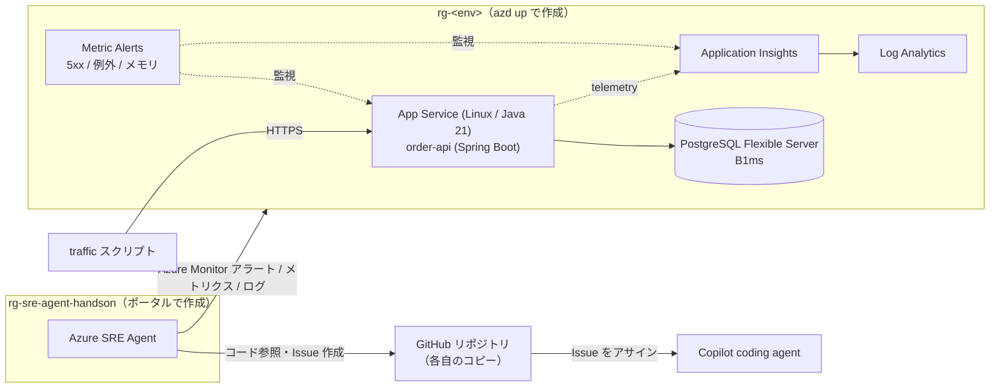

# Azure SRE Agent ハンズオン

[Azure SRE Agent](https://learn.microsoft.com/azure/sre-agent/overview) を実際に触り、次の 3 つのシナリオを体験するハンズオンです。

| # | シナリオ | 体験すること |
| --- | --- | --- |
| 1 | **インフラ側インシデント**（PostgreSQL 停止） | アラートを起点に Agent が自動調査します。Activity Log から原因を特定し、**承認付き**で DB を再起動させます |
| 2 | **アプリ側インシデント**（不具合版のデプロイ） | Agent が App Insights の例外と GitHub のソースコードから原因箇所を特定します。そのうえで **GitHub Issue を作成**し、Copilot coding agent に修正を任せます |
| 3 | **アラートの予兆チェック**（メモリ増加） | **Scheduled Task** でメトリクスの傾向を定期的に分析させ、アラートが発火する**前に**警告させます |

- 対象: Azure / アプリ運用の基本操作ができるエンジニア
- 所要時間: 約 2〜3 時間
- 実施形態: 参加者が**各自の Azure サブスクリプション**で実施します

## アーキテクチャ

Azure 側の構成は、学習に必要な最小限に絞っています。



## 手順

| 手順 | 内容 | 目安 |
| --- | --- | --- |
| [00. 事前準備](docs/00-prerequisites.md) | 権限・ツール・リポジトリの準備 | 15 分 |
| [01. アプリのデプロイ](docs/01-deploy.md) | `azd up` で Azure 環境とアプリを構築 | 20 分 |
| [02. SRE Agent の作成と接続](docs/02-create-sre-agent.md) | Agent 作成、GitHub・Azure Monitor との接続、応答プラン | 25 分 |
| [03. シナリオ 1: インフラ側インシデント](docs/03-scenario-infra.md) | PostgreSQL 停止 → 調査 → 承認付き復旧 | 30 分 |
| [04. シナリオ 2: アプリ側インシデント](docs/04-scenario-app.md) | 不具合版デプロイ → 原因特定 → Issue → Copilot | 30 分 |
| [05. シナリオ 3: アラートの予兆チェック](docs/05-scenario-proactive.md) | Scheduled Task によるメモリ傾向の分析 | 30 分 |
| [99. 後片付け](docs/99-cleanup.md) | **必ず実施**（SRE Agent は存在するだけで課金されます） | 5 分 |

追加シナリオのアイデアは [future-scenarios.md](docs/future-scenarios.md) にまとめています。

## リポジトリ構成

```
.
├── azure.yaml              # azd の定義
├── infra/                  # Bicep（App Service / PostgreSQL / App Insights / アラート）
├── app/                    # 注文 API（Java 21 / Spring Boot / Gradle）
├── scripts/                # トラフィック生成・メモリ増加スクリプト（bash / PowerShell）
└── docs/                   # 手順書・Agent に読ませる Runbook
```

ブランチ:

- `main`: 正常版のアプリ
- `incident/app-bug`: シナリオ 2 用の**不具合入り**ブランチ（中身はシナリオ 2 を終えるまで見ないでください）

## サンプルアプリ（order-api）

| メソッド | パス | 説明 |
| --- | --- | --- |
| GET | `/api/products` | 商品一覧 |
| POST | `/api/orders` | 注文（`{"productId":1,"quantity":2,"couponCode":"WELCOME10"}`、`couponCode` は任意） |
| GET | `/api/orders/{id}` | 注文の取得 |
| POST / GET / DELETE | `/api/debug/leak?mb=20` | シナリオ 3 用。メモリを意図的に保持・参照・解放します（`APP_LEAK_ENABLED=true` のときだけ有効） |
| GET | `/actuator/health` | ヘルスチェック |

ローカルでは H2 インメモリ DB で動きます。

```bash
cd app
./gradlew bootRun
```

## 注意事項

- このリポジトリは**学習用**です。DB パスワードを App Settings に直接設定したり、PostgreSQL のファイアウォールで Azure サービスからの接続を許可したりと、手順を簡単にするための設定を含みます。本番では Key Vault 参照や Entra ID 認証、Private Endpoint などを使ってください。
- Azure SRE Agent の画面や機能は頻繁に更新されます。手順と実際の画面が違う場合は [公式ドキュメント](https://learn.microsoft.com/azure/sre-agent/) を優先してください。
