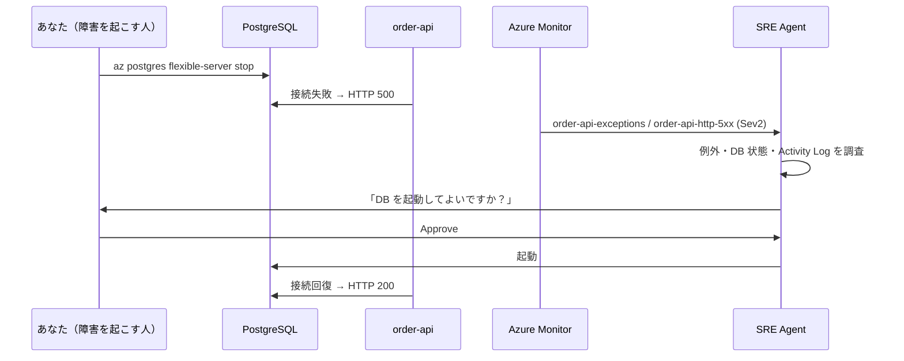

# 03. シナリオ 1: インフラ側インシデント（PostgreSQL 停止）

## このシナリオで体験すること

- Azure Monitor のアラートを起点に、SRE Agent が**自動で調査を始める**こと
- アプリの例外（DB 接続エラー）、DB の状態、Activity Log（**誰がいつ何をしたか**）を Agent が突き合わせて原因を特定すること
- **Review モード**で、Agent が DB を起動する前に**承認を求めてくる**こと



## 1. 準備

- [01. アプリのデプロイ](01-deploy.md) の `traffic` スクリプトが動いていることを確認します（止まっていたら再実行します）。
- 環境変数を用意します。

```bash
RG=$(azd env get-value AZURE_RESOURCE_GROUP)
PG=$(azd env get-value POSTGRES_SERVER_NAME)
```

```powershell
$RG = azd env get-value AZURE_RESOURCE_GROUP
$PG = azd env get-value POSTGRES_SERVER_NAME
```

## 2. 障害を起こす

PostgreSQL を停止します（完了まで数分かかります）。

```bash
az postgres flexible-server stop --resource-group $RG --name $PG
```

停止が進むと、`traffic` スクリプトの出力が `500` に変わります（DB 接続のタイムアウト待ちで、1 リクエストに 5 秒ほどかかります）。

> [!NOTE]
> 停止した Flexible Server は 7 日後に自動で起動しますが、このハンズオンでは Agent に起動させます。

## 3. アラートの発火と自動調査を待つ

5 分ほどで `order-api-exceptions` と `order-api-http-5xx` が発火します（どちらも Sev2 なので、両方のインシデントで調査が始まります）。

1. Azure ポータルの **監視** → **アラート** でアラートが発火したことを確認します（メールを設定した場合はメールも届きます）。
2. SRE Agent のポータルで **Incidents**（インシデント一覧）を開きます。`order-api-` で始まるインシデントが表示され、応答プラン `order-api-alerts` による調査が始まっていることを確認します。
3. インシデントを開き、Agent の調査の過程（実行したクエリや参照したリソース）を眺めます。

### 期待される調査結果の例

Agent の回答は毎回少しずつ異なりますが、おおむね次の内容が含まれていれば成功です。

- **影響**: `GET /api/products` と `POST /api/orders` がすべて 500 になっている
- **根拠**: App Insights の例外に `CannotCreateTransactionException`（Could not open JPA EntityManager for transaction）、`SocketTimeoutException`（Connect timed out）、`PSQLException`（The connection attempt failed.）が大量に出ている
- **原因**: PostgreSQL Flexible Server の状態が `Stopped`。Activity Log に **Stops an existing server** の操作と、その**実行者（あなたのアカウント）**と時刻が記録されている
- **推奨対応**: PostgreSQL を起動する

## 4. 承認して復旧させる

Review モードなので、Agent は DB を起動する前に承認を求めます。

1. インシデントのスレッドに **Approve / Deny** が表示されたら、操作の内容（対象リソースとコマンド）を確認して **Approve** を選びます。
2. Agent が自分から起動を提案しない場合は、チャットで依頼します。

   ```text
   PostgreSQL サーバーを起動して、order-api が回復したことを確認してください。
   ```

3. 数分後、`traffic` スクリプトの出力が `200` / `201` に戻ることを確認します。

> [!TIP]
> 承認のボタンが出ない、または権限エラーになる場合は、Agent のリソース アクセスが **Reader** になっていないか確認してください（[02. SRE Agent の作成と接続](02-create-sre-agent.md#azure-resources)）。

## 5. 振り返り（チャットで聞いてみる）

```text
今回のインシデントのタイムライン（障害発生、検知、原因特定、復旧）を時刻付きでまとめてください。
```

```text
同じ障害を早く検知・防止するために、監視やアラート、運用ルールで改善できることを提案してください。
```

```text
アプリ側で DB 停止の影響を小さくするために、コードや設定で何ができますか？リポジトリのコードを見て具体的に提案してください。
```

アラートは DB が回復してしばらくすると自動で解決（Resolved）になります。

## うまくいかないとき

| 症状 | 確認すること |
| --- | --- |
| アラートが発火しない | `traffic` スクリプトが動いているか。5xx が 5 分間で 10 件を超えている必要があります |
| インシデントが Agent に表示されない | 応答プランの Severity（Sev2）と **Title contains: `order-api`** の設定、Azure Monitor の接続状態 |
| Agent が DB を起動できない | Agent のマネージド ID に `rg-<環境名>` の **Privileged**（Contributor 相当）権限があるか |

---

次へ: [04. シナリオ 2: アプリ側インシデント](04-scenario-app.md)
