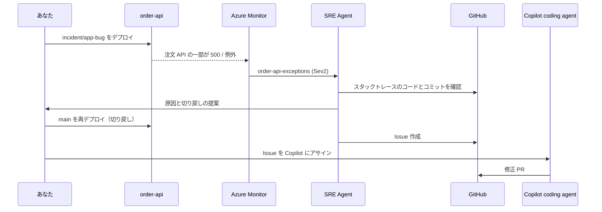

# 04. シナリオ 2: アプリ側インシデント（不具合版のデプロイ）

## このシナリオで体験すること

- 「リファクタリング」のつもりで入ったバグを、SRE Agent が次の情報を突き合わせて特定すること
  - App Insights の例外とスタックトレース
  - デプロイ時刻
  - **GitHub のソースコードとコミット**
- Agent に **GitHub Issue** を作らせ、**Copilot coding agent** に修正を任せること
- 暫定対応（正常版への切り戻し）と恒久対応（コード修正）を分けて進めること



> [!IMPORTANT]
> `incident/app-bug` ブランチの差分は、シナリオが終わるまで**見ないで**進めてください。原因を探すのは Agent の役目です。

## 1. 準備

- `traffic` スクリプトが `200` / `201` を返していることを確認します。
- Azure ポータルの **監視** → **アラート** で、シナリオ 1 のアラート（`order-api-exceptions` / `order-api-http-5xx`）が**解決済み (Resolved)** になっていることを確認します。DB の復旧後、解決までに 10 分ほどかかります。

> [!IMPORTANT]
> アラートが発火中 (Fired) のままだと、新しいアラート（＝新しいインシデント）が作られません。必ず Resolved になってから次に進んでください。
- `traffic` スクリプトは、約 7 割の注文を**クーポンなし**、約 3 割を**クーポンあり**で送っています。

## 2. 不具合版をデプロイする

「クーポン コードの正規化」というリファクタリングを含むバージョンをデプロイします。

```bash
git switch incident/app-bug
azd deploy
```

> [!NOTE]
> `.azure/` フォルダー（azd の環境設定）は Git の管理対象外なので、ブランチを切り替えても同じ環境にデプロイされます。

デプロイが終わると、`traffic` スクリプトの出力で**一部の注文だけ**が `500` になります。`GET /api/products` と、クーポンありの注文は成功し続けます。

> [!TIP]
> 「すべてが落ちるわけではない」点がこのシナリオのポイントです。どのリクエストが失敗しているのかを Agent が切り分けられるか、注目してください。

## 3. アラートと自動調査

5〜10 分ほどで `order-api-exceptions`（と、場合によっては `order-api-http-5xx`）が発火します。SRE Agent の **Incidents** でインシデントを開き、調査の過程を確認します。

### 期待される調査結果の例

- **影響**: `POST /api/orders` の一部（クーポンなしの注文）だけが 500。商品一覧やクーポンありの注文は正常
- **根拠**: App Insights の例外が `java.lang.NullPointerException: Cannot invoke "String.strip()" because "couponCode" is null`。発生箇所は `CouponService.normalize`（`discountRateFor` から呼ばれている）
- **時系列**: 例外が出始めたのは App Service への**デプロイの直後**
- **コード**: GitHub リポジトリの `incident/app-bug` ブランチの `CouponService.java` で、`couponCode` が `null`（クーポン未指定）のときにも `strip()` を呼んでいる。「クーポン コードの正規化」のコミットで null チェックが消えている
- **推奨対応**: 暫定対応として正常版に切り戻し、恒久対応として null（未指定）を考慮したコードに修正する

Agent がコードまでたどり着かない場合は、チャットで後押しします。

```text
スタックトレースに出ているクラスを、接続している GitHub リポジトリの incident/app-bug ブランチで確認し、原因となっている行と、その変更を入れたコミットを特定してください。
```

## 4. 暫定対応: 正常版に切り戻す

まずはサービスを回復させます。Agent に切り戻しの方法を聞いてみましょう。

```text
すぐにサービスを回復させたいです。今回のデプロイ方式（azd / App Service へ zip デプロイ）を踏まえて、切り戻しの手順を教えてください。
```

このハンズオンではデプロイ スロットを使っていないので、正常版の `main` を再デプロイして切り戻します。

```bash
git switch main
azd deploy
```

`traffic` スクリプトの出力がすべて `200` / `201` に戻ることを確認します。

## 5. 恒久対応: Issue を作り、Copilot coding agent に任せる

### Agent に Issue を作らせる

チャットで次のように依頼します。

```text
今回のインシデントについて、接続している GitHub リポジトリに Issue を作成してください。
タイトル、影響範囲、原因（ファイル名と行、原因となったコミット）、再現手順、修正方針、追加すべきテストを含めてください。
修正対象のブランチは incident/app-bug です。
```

GitHub でリポジトリの **Issues** を開き、Issue が作成されていることを確認します。

### Copilot coding agent にアサインする（任意）

> Copilot coding agent を使えるプランが必要です。使えない場合は、Issue の内容を確認したところでこのシナリオは完了です。

1. 作成された Issue を開き、**Assignees** で **Copilot** を選びます。
2. 割り当ての画面でベース ブランチを選べる場合は、**`incident/app-bug`** を選びます（`main` にはバグがないため）。
3. しばらくすると Copilot がプル リクエストを作成します。修正内容とテスト（クーポン未指定の注文のテスト）が含まれていることを確認します。

> [!TIP]
> 余裕があれば、Copilot の修正をマージした `incident/app-bug` を再デプロイ（`git switch incident/app-bug && git pull && azd deploy`）して、エラーが出なくなることを確認してみてください。確認後は `git switch main && azd deploy` で `main` に戻しておきます。

## 6. 振り返り

```text
今回の不具合は、なぜデプロイ前に検知できなかったのでしょうか？既存のテストコードとデプロイ手順（azure.yaml）を確認し、テストとデプロイ プロセスの両面から改善策を提案してください。
```

```text
このようなデプロイ起因の障害を、デプロイ前やデプロイ直後に検知するための仕組みを提案してください。
```

ここまで終わったら、バグの差分を確認してみましょう。

```bash
git diff main incident/app-bug
```

---

次へ: [05. シナリオ 3: アラートの予兆チェック](05-scenario-proactive.md)
