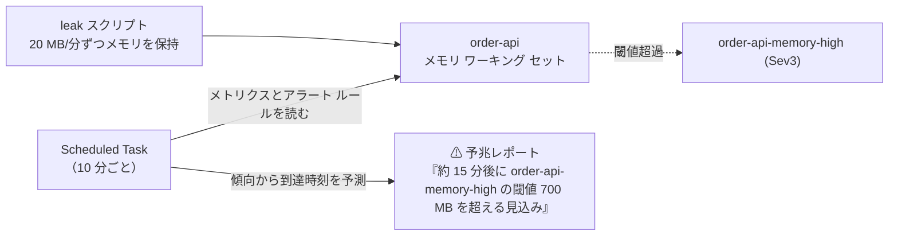

# 05. シナリオ 3: アラートの予兆チェック（メモリ増加）

## このシナリオで体験すること

- **Scheduled Task**（定期実行タスク）で、SRE Agent にメトリクスの傾向を定期的に分析させること
- アラートの閾値に**達する前に**、「このままだと何分後に閾値を超えるか」を Agent に警告させること
- インシデント対応（受け身）だけでなく、**予防的な運用**に Agent を使えること



## 1. Scheduled Task を作る

1. SRE Agent のポータルで **Automation** → **Create** → **Scheduled task** を選びます。
2. 次のように設定します。

   | 項目 | 値 |
   | --- | --- |
   | Name | `order-api-alert-forecast` |
   | Schedule | **10 分ごと**（cron の場合は `*/10 * * * *`） |
   | Autonomy level | **Review**（このタスクでは読み取りだけを行います） |
   | Run limit | 例: 12 回（2 時間で自動的に止まるようにする） |
   | その他 | 既定値 |

3. **Instructions** に次の内容を貼り付けます（`<環境名>` は自分のものに置き換えます）。

```text
あなたは order-api の予兆監視担当です。リソース グループ rg-<環境名> について、アラートが発火する前の兆候を調べてください。

1. rg-<環境名> のメトリック アラート ルールのうち、名前が order-api- で始まるものをすべて取得し、対象メトリック、集計方法、閾値、現在の状態（発火中かどうか）を確認してください。
2. 各ルールの対象メトリックについて、直近 60 分の値を 5 分間隔で取得してください。
3. 発火していないルールのうち、値が増加傾向にあるものについて、直近の傾き（単位時間あたりの増加量）から、閾値に到達するまでのおおよその時間を推定してください。
4. 60 分以内に閾値に到達する見込みのルールがあれば「⚠ 予兆あり」として、次をまとめてください。
   - 対象のアラート ルール名、現在値、閾値、増加ペース、到達予測時刻
   - 増加の原因の候補（Application Insights の requests から、増加が始まった時刻に呼ばれ始めたエンドポイントなど）
   - 推奨する対応（実行はしないこと）
5. 該当がなければ「✅ 予兆なし」と、各ルールの現在値と閾値を 1 行ずつ簡潔に報告してください。

このタスクでは Azure リソースへの変更操作は行わないでください。回答は日本語でお願いします。
```

4. **Create** を選びます。

> [!NOTE]
> 作成直後や次の実行時刻を待つ間に、タスクの実行結果に「✅ 予兆なし」と各ルールの現在値が報告されることを確認しておくと、比較しやすくなります。

## 2. メモリを少しずつ増やす

アプリのデバッグ用エンドポイント `/api/debug/leak` を使って、1 分ごとに 20 MB ずつメモリを保持させます（既定で 25 回、合計 500 MB まで）。**別のターミナル**で実行します。

```bash
./scripts/leak.sh
```

```powershell
./scripts/leak.ps1
```

App Service のメモリ ワーキング セットは、通常 350〜400 MB 前後です。このペースだと**約 15〜20 分で** `order-api-memory-high` の閾値（700 MB）を超えます。

> [!TIP]
> Azure ポータルで App Service の **監視** → **メトリック** を開き、**メモリ ワーキング セット**（平均）をグラフにしておくと、増えていく様子が分かります。

## 3. 予兆レポートを確認する

Scheduled Task の実行結果（**Automation** の該当タスクの実行履歴、またはそこから開けるスレッド）を確認します。メモリが増え始めてから次の実行で、次のようなレポートが出れば成功です。

```text
⚠ 予兆あり
- order-api-memory-high: 現在 520 MB / 閾値 700 MB、約 20 MB/分で増加中。約 9 分後（14:32 ごろ）に到達する見込み
- 原因の候補: 14:05 以降、POST /api/debug/leak が 1 分おきに呼ばれ続けている
- 推奨対応: 呼び出し元の停止、DELETE /api/debug/leak によるメモリ解放、または App Service の再起動
```

> [!NOTE]
> 実行のタイミングによっては、予兆レポートより先にアラートが発火することがあります。その場合はスケジュールを短くするか、`leak` スクリプトの間隔を延ばして（例: `./scripts/leak.sh "$(azd env get-value API_URI)" 20 120`）もう一度試してください。

## 4. 予兆に対応する

レポートの推奨対応に沿って、アラートが発火する前に手を打ちます。

1. `leak` スクリプトを **Ctrl+C** で止めます。
2. 保持しているメモリを解放します。

   ```bash
   curl -X DELETE "$(azd env get-value API_URI)/api/debug/leak"
   ```

   ```powershell
   Invoke-RestMethod "$(azd env get-value API_URI)/api/debug/leak" -Method Delete
   ```

3. 次の Scheduled Task の実行で、メモリが減少（または横ばい）に転じたことが報告されるのを確認します。

> [!NOTE]
> JVM はヒープを解放しても OS にすぐメモリを返さないことがあり、ワーキング セットがすぐには下がらない場合があります。下がらないときは App Service を再起動するか、Agent に「order-api を再起動して」と依頼してみましょう（Review モードなので承認を求められます）。

## 5. 発展: アラートを発火させてみる（任意）

予兆を無視するとどうなるかも試せます。`leak` スクリプトを最後まで実行すると `order-api-memory-high` が発火し、応答プラン `order-api-alerts`（Sev3 を含む）によって Agent の調査が始まります。Scheduled Task が事前に出していた予兆レポートと、インシデント調査の内容を見比べてみてください。

## 6. 後始末

Scheduled Task は実行のたびに課金（active flow）が発生します。シナリオが終わったら、**Automation** から `order-api-alert-forecast` を**無効化または削除**してください。

---

次へ: [99. 後片付け](99-cleanup.md)
